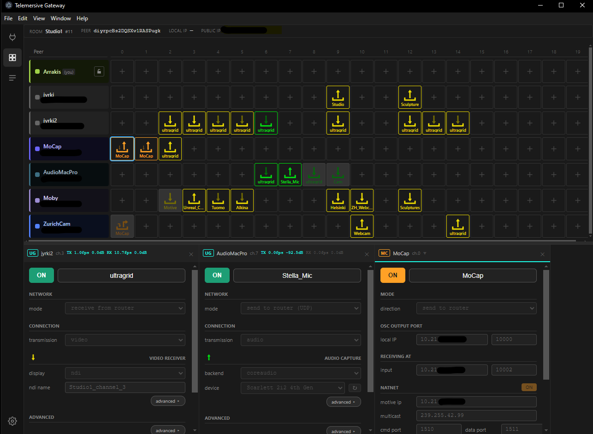

# Telemersive Gateway

[](https://github.com/telemersion/telemersive-portbay/releases/latest)


Telemersive Gateway is a desktop app for joining a telemersive-bus room — a shared MQTT-based session for routing video, audio, OSC, and motion-capture data between remote participants. It bridges local UltraGrid, OSC, and Motive devices into the room. It is a drop-in replacement for the Max MSP implementation of the Telemersive Gateway and is wire-compatible, so rooms mixing the two work.

> **On the repository name.** The app was prototyped as *Portbay*; the product is Telemersive Gateway. The repository, its release URLs and the documentation site still use `telemersive-portbay` so that existing links, downloads and the auto-updater keep working.

📖 **[Documentation](https://telemersion.github.io/telemersive-portbay/)**



See [docs/spec.md](docs/spec.md) for the protocol and design specification, and [CLAUDE.md](CLAUDE.md) for an architecture overview. User-facing documentation lives under [docs/](docs/) and is published with MkDocs Material — see [scripts/docs-screenshots/README.md](scripts/docs-screenshots/README.md) for how its screenshots are generated.

## Supported devices

- **UltraGrid** — video and audio relay (uses the UltraGrid CLI; located on first run)
- **OSC** — bidirectional OSC message relay
- **StageControl** — OSC variant for stage automation cues
- **Mocap** — Optitrack NatNet to OSC relay
- **Motive Bridge** — Optitrack NatNet protocol relay 


## Requirements

- **[Node.js]** 18+ and **[npm]**

### Linux and MacOS
link to download and install [Node.js and npm](https://docs.npmjs.com/downloading-and-installing-node-js-and-npm)

Once Node.js and npm are installed, you can verify the installation by running the following commands in your terminal:

```sh
node -v
npm -v
```

### Windows
link to download and install [nvm](https://github.com/coreybutler/nvm-windows/releases) -> nvm-setup.exe 

* restart Powershell

```
nvm install lts        # install latest LTS version
nvm use lts            # activate it
node --version         # verify
```

then set the execution policiy:

```
Set-ExecutionPolicy -Scope CurrentUser -ExecutionPolicy RemoteSigned
```
and confirm with [A]

```
 npm -v                 # verify
```

then follow the instructions below to install and run the app.

## Install and run

Inside the terminal, `cd` to a directory where you want to have your local folder for the project, then run the following commands:

```sh
git clone https://github.com/telemersion/telemersive-portbay.git
cd telemersive-portbay
npm install
npm run dev
```

This starts the electron-vite dev server with HMR for the renderer and live-reload for the main and preload processes. The app window opens automatically.

Use the in-app session UI to pick a room and join.

## First-run setup

On first launch, open the **Settings** view and find the **Tools & Compatibility** section. The app checks whether **UltraGrid** and **NatNetFour2OSC** (currently Windows only) are installed at compatible versions and shows the status of each. For any tool marked missing or version-mismatched, use **Download required build from official website ↗** to get the right version, then **Locate…** to point the app at the installed binary. The app validates the version and persists the path.

UltraGrid is needed for video/audio channels. [NatNetFour2OSC](https://github.com/immersive-arts/NatNetFour2OSC/releases) v1.2.0 is needed for NatNet and Motive channels. OSC and StageControl channels need no external tools.

## Project layout

- [src/main/](src/main/) — Electron main process: MQTT client, device router, child-process handlers
- [src/renderer/](src/renderer/) — Vue 3 UI; reconstructs room state from the MQTT stream forwarded over IPC
- [src/preload/](src/preload/) — thin IPC bridge between main and renderer
- [src/shared/](src/shared/) — topic helpers and shared types
- [tests/](tests/) — vitest suite with golden UG fixtures
- [vendor/ultragrid/](vendor/ultragrid/) — per-version UG installs (gitignored except for the README)

## Development

- `npm run typecheck` — type-check main + renderer (`vue-tsc --noEmit`)
- `npm test` — run the full vitest suite
- `npx vitest run tests/main/devices/OscDevice.test.ts` — run a single test file
- `npx vitest run tests/main/enumeration/parsers` — run only the UG parser tests
- `npm run build` — production build into `out/`
- `npm run preview` — launch the built app from `out/` without HMR
- `npm run docs:screenshots` — regenerate the documentation screenshots from the live app
- `npm run docs:serve` — serve the documentation site locally (needs `.venv-docs`, see below)

UltraGrid CLI output changes between versions, so the parsers in [src/main/enumeration/parsers/](src/main/enumeration/parsers/) are version-coupled. Upgrading the vendored UltraGrid is a deliberate multi-step procedure — see [docs/upgrading-ultragrid.md](docs/upgrading-ultragrid.md) for the full runbook, and [vendor/ultragrid/README.md](vendor/ultragrid/README.md) for vendor layout details.

## Documentation

The user manual is built with MkDocs Material and published to GitHub Pages by
[.github/workflows/docs.yml](.github/workflows/docs.yml) on every push to `master`.

```sh
python3.12 -m venv .venv-docs
.venv-docs/bin/pip install -r requirements-docs.txt
npm run docs:serve        # http://127.0.0.1:8000
npm run docs:build        # strict build, fails on broken links
```

Screenshots under `docs/assets/screenshots/` are generated from the running app
by `npm run docs:screenshots` — no broker or second machine required. Re-run it
and commit the result whenever the UI changes.

## Releasing

Use `npm version` to bump both atomically:

```sh
npm version patch   # 0.1.4 → 0.1.5  (bug fixes)
npm version minor   # 0.1.4 → 0.2.0  (new features)
npm version major   # 0.1.4 → 1.0.0  (breaking changes)
```

This updates `package.json`, commits the change, and creates a matching git tag (e.g. `v0.1.5`). Then push both:

```sh
git push && git push --tags
```

To build the installer locally:

```sh
npm run package     # runs build + electron-builder → dist/
```

## Issues

Bugs and feature requests: [GitHub Issues](../../issues).

## License

MIT. Copyright © 2024–2026 Martin Froehlich (maybites) for Immersive Art Space and Zürich University of the Arts (ZHdK). See [LICENSE](LICENSE).
