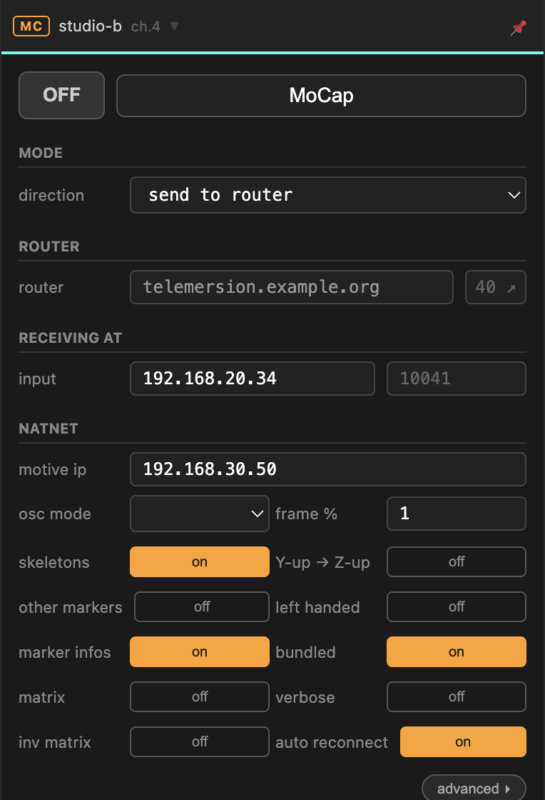
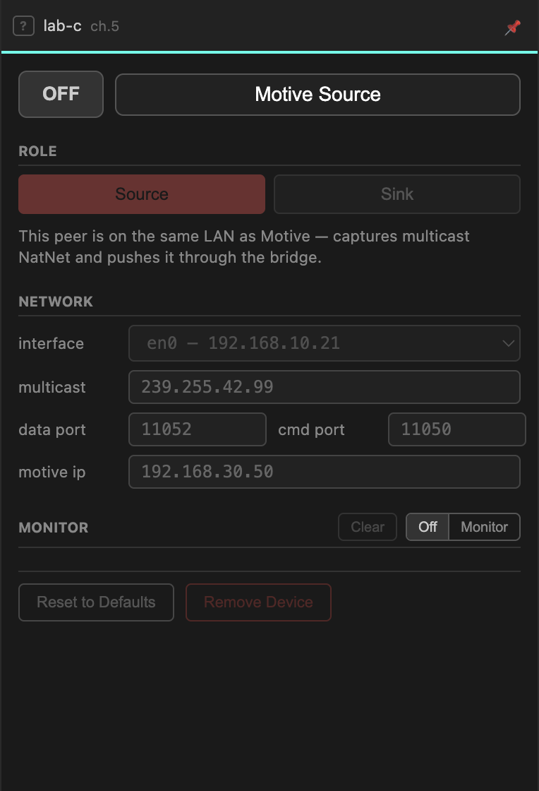

# Motion capture

Two devices carry OptiTrack data between locations. They solve different
problems, and picking the wrong one costs you a lot of debugging.

| | **MoCap** | **Motive bridge** |
| --- | --- | --- |
| Sends | NatNet converted to OSC | native NatNet, untouched |
| Far end receives | OSC messages | NatNet, re-multicast on its LAN |
| Needs NatNetFour2OSC | yes — **Windows only** | no |
| Use when | the far end consumes OSC | the far end runs software expecting Motive |

**Rule of thumb:** if the receiving side wants to talk to Motive, use the Motive
bridge. If it just wants coordinates, use MoCap.

---

## MoCap (NatNetFour2OSC)

Wraps [NatNetFour2OSC](https://github.com/immersive-arts/NatNetFour2OSC), which
connects to Motive and converts its stream to OSC.

!!! warning "Windows only for sending"
    NatNetFour2OSC exists only for Windows. On macOS and Linux the sending
    directions are disabled — you can still **receive from router**, because
    that is plain OSC and needs no tool at all.

### Direction

| | |
| --- | --- |
| **send to router** | connect to Motive, convert, publish to the room |
| **send to local** | connect to Motive, convert, send to a local address only |
| **receive from router** | take the converted OSC off the room and forward it locally |

### Connecting to Motive

| Field | |
| --- | --- |
| **motive ip** | the machine running Motive |
| **cmd port / data port** | NatNet's command and data ports — `1510` / `1511` unless changed in Motive |
| **multicast** | Motive's multicast group, when it is set to multicast |

### What to send

Toggles select which parts of the stream to convert: **skeletons**, **marker
infos**, **other markers**. Each one costs bandwidth and CPU — send only what
the far end will use. Untick *other markers* first; it is usually the largest
and least useful.

**frame %** thins the stream. `1` sends every frame, `2` every second. Halving
the rate of a 240 Hz capture is often invisible downstream and makes a large
difference to the link.

Coordinate-system options — **Y-up → Z-up**, **left handed**, **matrix**, **inv
matrix** — convert into whatever convention the receiving software expects. Get
these wrong and the data arrives fine but everything is mirrored or on its side.

**auto reconnect** re-establishes the Motive connection if it drops. Leave it on.

---

## Motive bridge

Carries native NatNet traffic and re-multicasts it at the far end, so software
there sees Motive as though it were on the local network. No conversion, no
NatNetFour2OSC, and it works on every platform.

### Role

| | |
| --- | --- |
| **Source** | this peer is on the same LAN as Motive. It captures the multicast NatNet and pushes it through the bridge. |
| **Sink** | this peer re-multicasts the incoming NatNet on its own LAN. |

Exactly one peer per channel is Source. Every other peer that needs the data is a
Sink.

### Network

| Field | |
| --- | --- |
| **interface** | the network interface to capture from or multicast on |
| **multicast** | the multicast group — must match Motive's setting on the Source, and is what Sinks will re-multicast to |
| **data port / cmd port** | allocated by Portbay from the room's range |
| **motive ip** | the Motive machine, on the Source side |

The **interface** matters more here than elsewhere. Multicast is per-interface:
pick the wrong one and the Source captures nothing while looking perfectly
configured.

---

## Troubleshooting

| Symptom | Likely cause |
| --- | --- |
| MoCap device cannot be added | Not Windows, or NatNetFour2OSC is not installed — see [Tools](../getting-started/tools.md). |
| Device on, nothing flowing | Motive is not streaming, or `motive ip` / ports are wrong. Open the **Monitor** and read what the tool reports. |
| Motive bridge Source sees nothing | Wrong **interface**, or Motive is set to unicast rather than multicast. |
| Sink receives but local software does not | The software is listening on a different interface or multicast group than the Sink re-multicasts to. |
| Data arrives mirrored or rotated | Coordinate conversion toggles. |
| Stream stutters | Raise **frame %**, or send fewer marker categories. |
