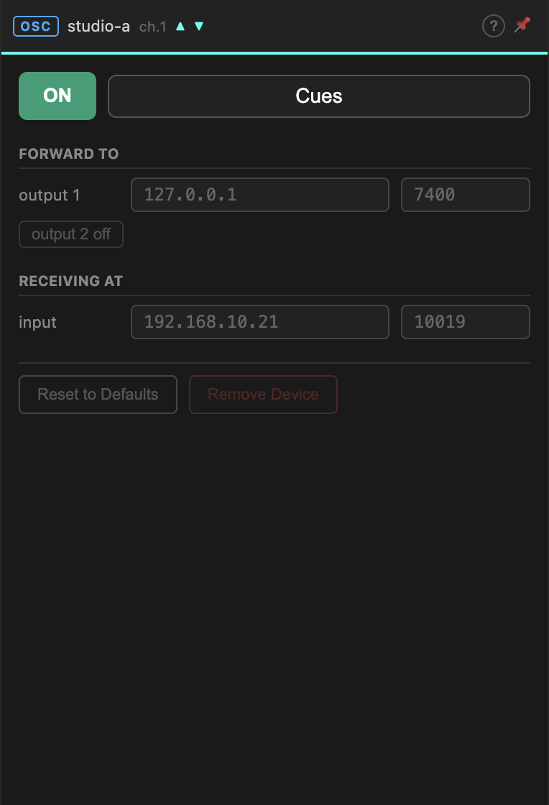

# OSC

Carries OSC messages between the peers in a room. Everyone with an OSC device on
the same channel sees everyone else's messages.

The panel has two halves, and the thing to hold on to is that they describe
**your machine**, not the far end. You never configure the other peers — they
configure themselves.

## Forward to

Where this device sends the OSC it receives *from the room*.

| Field | |
| --- | --- |
| **output 1** | IP address and port on your LAN. `127.0.0.1` for something on this machine. |
| **output 2** | An optional second destination. Press `output 2 off` to enable it. |

Point these at whatever should react to remote OSC — a Max patch, a QLab
machine, a lighting desk.

Two outputs are useful when the same cues must reach two places: your own
machine and a console elsewhere in the building.

## Receiving at

Where this device listens for OSC *from your tools*, to forward into the room.
Both fields are read-only: the IP is the NetworkCard you chose at connect time,
and the port is allocated by the Gateway.

Send OSC to that address and port, and every peer with an OSC device on this
channel receives it.

!!! tip "The port is stable across rooms"
    Local ports depend only on the channel number, never on the room. Channel 1
    is port 10019 whether you are in room 11 or room 27, so a Max patch built
    against it keeps working when you rejoin somewhere else.

    Room-side ports *do* change with the room, but you never need those — every
    peer works them out locally.

## Switching it on

Press **ON**. The arrows in the matrix light up when data moves; the panel
header shows ▲ for outgoing and ▼ for incoming activity.

While the device is on its settings are locked. Switch off to change a port.

**Reset to Defaults** restores the allocated ports and clears the output
addresses.

## OSC is really lists

Messages travel over MQTT as strings, not as OSC packets. The Gateway serialises on
the way out and deserialises on the way in.

In practice this is invisible — in Max there is no difference between a list and
an OSC message. It matters in two places:

- **Type tags are not preserved.** Values arrive as their textual form.
- **Blobs and bundles do not survive.** Send them as separate messages.

## Troubleshooting

| Symptom | Likely cause |
| --- | --- |
| Nothing arrives at *output 1* | Nothing is being sent on this channel, or the far end's device is off. Check the other peers' cells in the matrix. |
| Your tool's OSC never leaves | Sending to the wrong address — use the **Receiving at** address, not `localhost`, unless your tool is on this machine. |
| Arrows stay dim on both ends | Firewall. See the [FAQ](../faq.md#firewall). |
| Messages arrive duplicated | Two OSC devices on the same channel forwarding to the same destination. |
