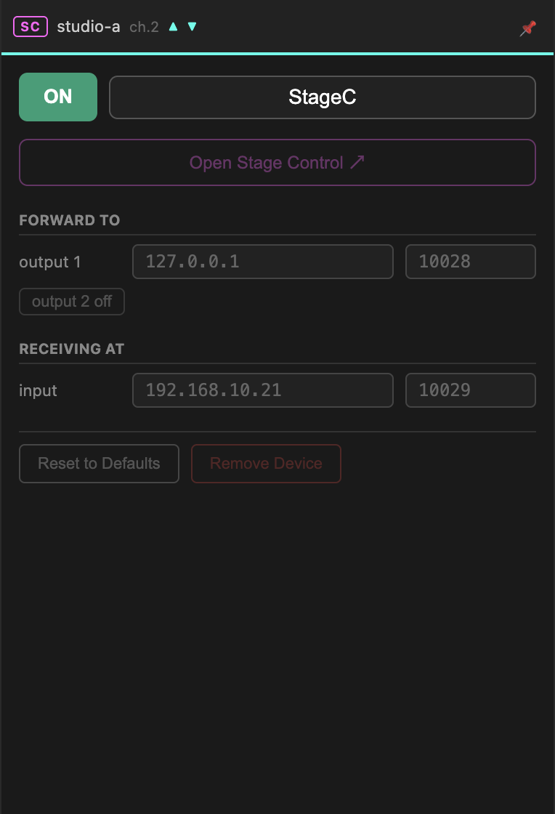

# Stage Control

[Open Stage Control](https://openstagecontrol.ammd.net/) is a free, open-source
OSC controller that runs in a browser. Every room gets its own instance on the
router, and this device connects your machine to it.

It is an [OSC device](osc.md) with a button on top — the routing fields behave
identically. What is different is the far end: instead of other peers, you are
talking to a control surface that everyone in the room shares.

## Opening the surface

**Open Stage Control ↗** opens your room's instance in the default browser. The
URL carries the room name as credentials, so the link works without a separate
login.

Anyone in the room can open the same URL and see the same surface. Faders move
for everybody.

!!! info "Screenshot pending"
    The editor with widgets placed — `ext-open-stage-control-editor.png`

Build your interface in the browser using
[Open Stage Control's editor](https://openstagecontrol.ammd.net/docs/user-interface/editor/).
The surface belongs to the room and lives on the router, so it survives your app
restarting — but it is removed with the room, once every peer has left. Export
anything you want to keep from within Open Stage Control itself.

## Routing

**Forward to** — where the OSC coming *from the control surface* is sent on your
machine. Point it at whatever the faders should drive.

**Receiving at** — send OSC here to update the surface, so that widgets reflect
the actual state of your system rather than just the last thing someone touched.

Both work exactly as described in [OSC](osc.md).

## What it is good for

- One shared surface every location can see and operate
- Cue lists and transport controls, where everyone needs the same buttons
- Monitoring, when you feed state back into the surface

## Troubleshooting

| Symptom | Likely cause |
| --- | --- |
| Button does nothing | The room has no Stage Control instance — check with whoever runs your router. |
| Browser cannot reach the URL | Your machine cannot reach the router on the room's Stage Control port. |
| Surface opens but nothing moves | The device is switched off, or **Forward to** points somewhere unexpected. |
| Widgets do not reflect reality | Nothing is sending state back to **Receiving at**. |
