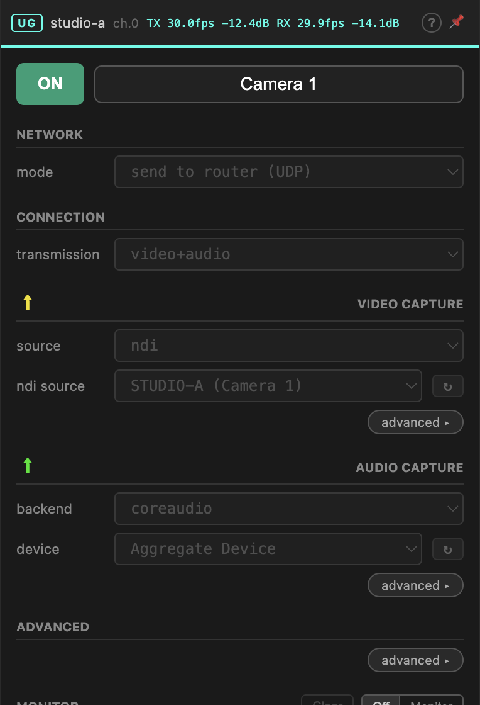
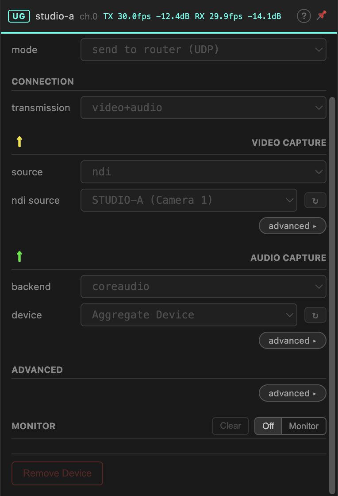
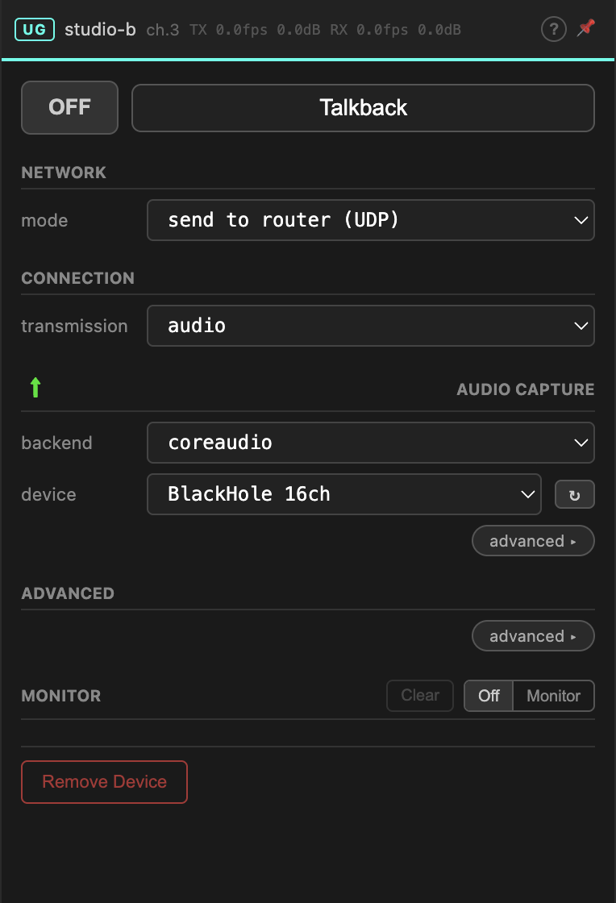

# UltraGrid

[UltraGrid](https://www.ultragrid.cz/) moves video and audio across a network
with very low latency. The Gateway runs it for you and gives it an interface, so
you never have to write a `uv` command line.

Each channel can send, receive, or do both.

Configure the panel top to bottom: **how it reaches the other side**, **which
direction and what media**, then **what to capture and where to put what
arrives**.

## 1. Network — how it reaches the other side

| Mode | Use when |
| --- | --- |
| **send to router (UDP)** | one sender, any number of receivers. The everyday choice. |
| **receive from router** | pick up a stream someone is sending on this channel. |
| **peer to peer (automatic)** | two machines on different networks, lowest possible latency. Attempts to punch through both firewalls; whether it works depends on your networks. |
| **peer to peer (manual)** | two machines you can address directly, typically on the same LAN. You enter the other machine's IP. |
| **capture to local** | no network at all — capture a local source and re-publish it locally in another format. |

Start with **send to router** / **receive from router**. They always work if the
router does, and they are the only modes that serve more than one receiver. Move
to peer-to-peer only when latency actually demands it.

When receiving, you can also pick a **channel** other than the device's own.
That lets one peer send on channel 1 and pull the same stream back down on
channel 2 for local use.

## 2. Connection & transmission — direction and media

**connection** — `send`, `receive` or `both`.
**transmission** — `video`, `audio` or `video+audio`.

Some combinations are fixed by the network mode and appear greyed out: *send to
router* forces `send`, *receive from router* forces `receive`. Peer-to-peer modes
let you choose.

!!! tip "Give audio its own channel"
    Video and audio in one device is convenient but couples them: reconfiguring
    the camera interrupts the talkback. Separate channels are more robust, and
    make it obvious in the matrix which one has stopped.

## 3. Video capture — what to send

| Source | |
| --- | --- |
| **texture** | Syphon (macOS) or Spout (Windows) — anything a local application is publishing |
| **ndi** | an NDI source on your network |
| **custom** | your own UltraGrid capture flags |

The `↻` button next to the source list re-scans. Sources that appeared after the
panel opened will not be listed until you press it.

Under **advanced**: codec, bitrate and frame rate. The defaults are sensible;
raise the bitrate for detailed material, lower it if the network cannot keep up.

## 4. Video receive — where to put it

The same three options in reverse: republish the incoming stream as a Syphon or
Spout texture, as NDI, or hand it to custom flags. Take the default name or set
your own — that name is what your compositing or playback software will look
for.

## 5. Audio

**backend** picks the audio system: `coreaudio` on macOS, `wasapi` on Windows,
`portaudio` anywhere, `jack` on Linux. Then pick the **device**.

Under **advanced** on the capture side you set the channel count; on the receive
side, the channel mapping. Sending 2 channels from an aggregate device and
landing them on specific outputs at the far end is covered step by step in
[Audio on macOS](../tutorials/audio-on-macos.md).

## Custom flags

Every section has a **custom** option that takes raw UltraGrid flags. The flags
editor carries a list of worked examples — click one to insert it, then edit.

Use it for hardware and formats the interface does not cover. If you find
yourself using it routinely for something ordinary, that is worth reporting as a
missing feature rather than a personal workaround.

## Monitoring a running device

The panel header shows live TX and RX frame rates and audio levels, read from
UltraGrid's own output. This is the fastest way to tell configured-but-silent
from actually-running.

**Monitor** opens UltraGrid's console output. It works for remote peers too, so
you can diagnose another location's stream from your own seat — which is the
point of it. Leave it **Off** when you are not reading it; it publishes
continuously.

!!! warning "No automatic restart"
    If UltraGrid exits, the Gateway switches the device off and leaves it off. It
    does not restart it. Open the monitor, read the error, fix the cause. A
    silent restart loop would just hide a missing capture device or a port
    collision.

## An idle device

Switched off, every field is editable. Switched on, everything locks — you
cannot change a port under a running stream. Off, change, on.

## Troubleshooting

| Symptom | Likely cause |
| --- | --- |
| Sender lit, receiver dark | Firewall on the receiving machine — see the [FAQ](../faq.md#firewall). Check the channel's [proxy clients](../guide/channel-proxies.md) to see whether the receiver ever reached the router. |
| Black texture at the receiver | On Windows, Spout needs a dedicated GPU and initialised settings — see the [FAQ](../faq.md). |
| Source list is empty | Press `↻`. If it stays empty, the source is not running, or UltraGrid cannot see it. |
| Video fine, audio degraded | Sending NDI audio alongside video can starve the video encoder. Route audio separately — see the [FAQ](../faq.md). |
| Works on LAN, not between sites | Peer-to-peer automatic could not punch through. Switch to send/receive via router. |
| Stutters at high bitrate | Lower the bitrate, or use a codec with a lower CPU cost. |
