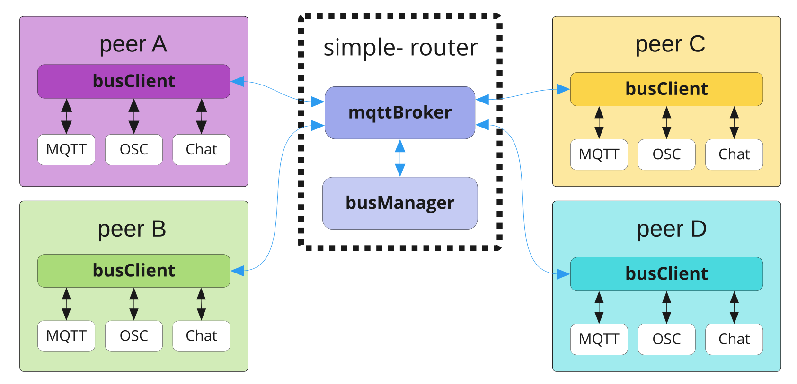

# FAQ

## Firewall

### One machine receives the stream, another does not

Almost always the firewall on the machine that is not receiving. Both Windows and
macOS ask for confirmation the first time an application accepts incoming
connections — usually once per channel — and a dismissed prompt fails silently
from then on.

=== "macOS"

    **System Settings → Network → Firewall → Options**, and allow incoming
    connections for the UltraGrid and NatNet processes.

    !!! info "Screenshot pending"
        The incoming-connection prompt — `os-macos-firewall-prompt.png`

    !!! info "Screenshot pending"
        Firewall options list — `os-macos-firewall-options.png`

=== "Windows"

    **Settings → Update & Security → Windows Security → Firewall and network
    protection → Allow an app through the firewall**, and tick both Private and
    Public for the UltraGrid and NatNet entries.

    !!! info "Screenshot pending"
        The allow-access dialog — `os-windows-firewall-prompt.png`

    !!! info "Screenshot pending"
        Allowed apps list — `os-windows-firewall-allowed-apps.png`

!!! warning "Process names"
    The exact process names to look for depend on the build and are not yet
    documented here. They appear in the prompt itself when you enable a device
    for the first time.

To confirm the firewall is the cause before changing anything, open the channel's
[proxy status](guide/channel-proxies.md). If the receiving peer never appears in
the client list, its packets are not reaching the router at all.

### Which ports need to be open?

See [Ports](reference/ports.md#firewall-rules).

## Video

### Sending a Spout stream, but the receiver gets a black texture

Check the local Spout settings. The sending machine needs to be able to share
textures over the GPU, which means a dedicated graphics card. Opening the Spout
settings (`C:\Program Files\SPOUT-2007\SPOUTSETTINGS`) and confirming with **OK**
has been enough to fix this.

!!! info "Screenshot pending"
    SPOUTSETTINGS dialog — `ext-spout-settings.png`

### Sending audio from an NDI stream degrades the video quality

Route the audio separately rather than taking it from the NDI source — on macOS
via [BlackHole](https://existential.audio/blackhole/), on Windows via a
comparable virtual cable. See [Audio on macOS](tutorials/audio-on-macos.md).

### The capture source list is empty

Press the `↻` button next to the list. It is only populated when the list is
built, so a source started afterwards will not appear until you refresh.

If it stays empty, the source is not actually publishing, or UltraGrid cannot see
it — check with a standalone Syphon/Spout/NDI monitor first.

## Rooms and peers

### I mistyped the room password when creating the room

The password is fixed for the life of the room and cannot be changed. Everyone
has to leave; once the last peer leaves, the router removes the room and you can
recreate it with the right password.

### A peer that is not there any more still shows in the matrix

Something force-quit and left its retained state on the broker. Have that machine
rejoin and leave properly, which clears it.

### Devices reappear after I removed them

The removal did not reach the broker — usually because the connection dropped
partway through. Check the [Activity log](guide/activity-log.md) for the
retained clears, and try again while connected.

### Can I be in two rooms at once?

No. One room per running instance.

## Performance

### Interactions feel sluggish

Every interaction makes a round trip to the broker before anything happens — see
[Activity log](guide/activity-log.md#why-it-looks-like-an-echo-chamber). On a
public broker 50–200 ms is normal. The timestamps of a `PUB`/`RECV` pair tell you
your actual round trip.

### Streams keep running but I cannot switch anything off

The broker connection has dropped. Media is UDP and never passes through the
broker, so it is unaffected — but all control does. Reconnect from the Session
view.

### A device switched itself off

UltraGrid or NatNetFour2OSC exited. The Gateway does not restart them; it switches
the device off and writes the error to the monitor log. Open **Monitor** on that
device and read it.

## Everything else

### Where are my settings stored?

See [Settings](guide/settings.md#configuration-file). The file contains your
router password in plain text — do not attach it to bug reports.

### Can I use this without a telemersive-router?

Not for this app. The
[telemersive-bus](https://github.com/telemersion/telemersive-bus) client library
offers a reduced feature set — chat, MQTT, OSC-as-lists, a connection speed test —
without needing a router, but not the device relaying that the Gateway is for.

### Does it work with the old Max gateway?

Yes, in the same room, in both directions. See
[Max compatibility](reference/max-compatibility.md).

### How do I report a problem?

Open an issue on
[GitHub](https://github.com/telemersion/telemersive-portbay/issues). Useful to
include: what you expected, what happened, your OS and app version (**About**),
and a copy of the [Activity log](guide/activity-log.md) — checked first for room
names, peer names and anything else you would rather not publish.
