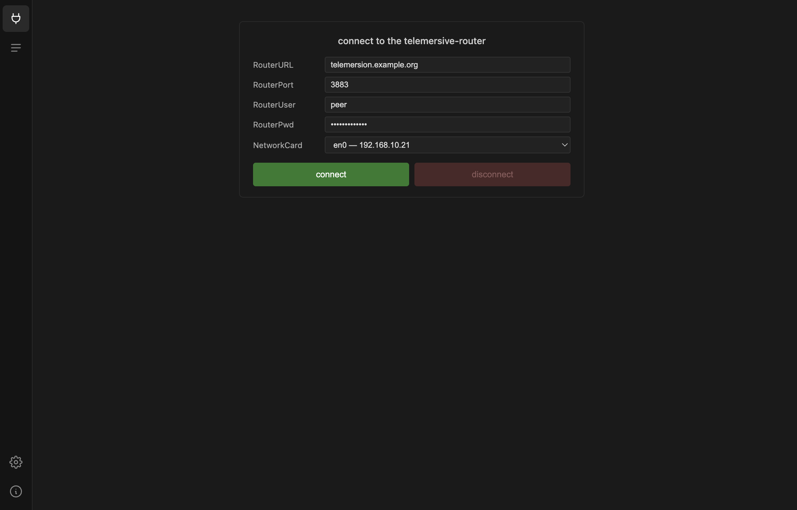
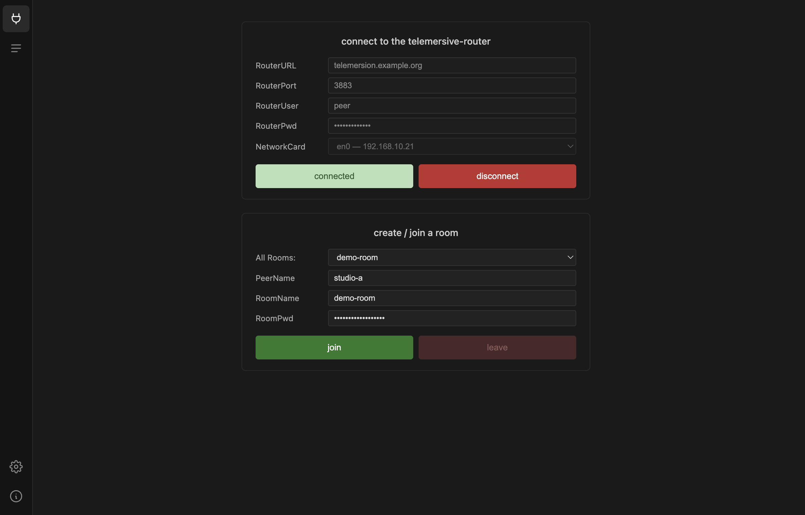
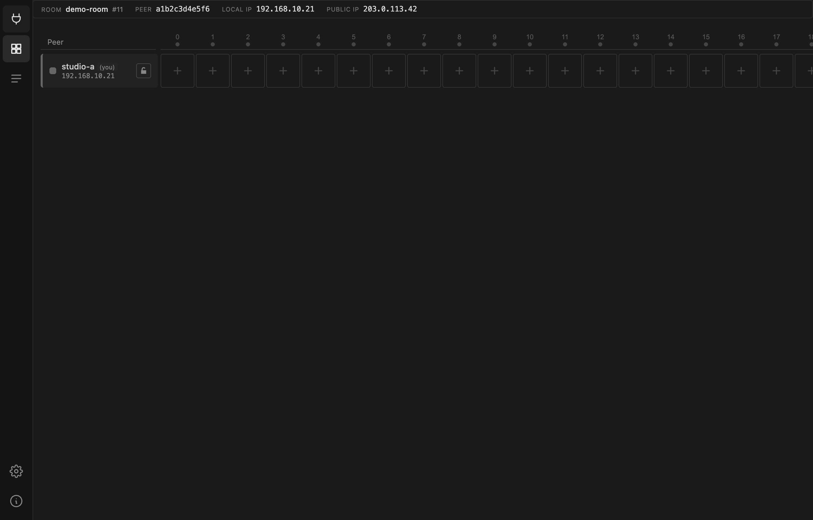
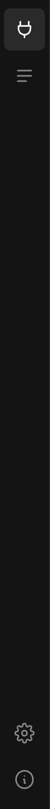

# Your first session

Getting into a room is two steps: connect to the router, then join a room on it.

## 1. Connect to the router

| Field | Example | Notes |
| --- | --- | --- |
| RouterURL | `telemersion.example.org` | hostname of your router |
| RouterPort | `3883` | the broker port |
| RouterUser | `peer` | |
| RouterPwd | | |
| NetworkCard | `en0 — 192.168.10.21` | which interface to use |

!!! warning "Treat router credentials as confidential"
    They are shared on a need-to-know basis. Do not paste them into tickets,
    chats or issue reports.

**NetworkCard** only matters if your machine has more than one interface — a
laptop on Wi-Fi and Ethernet, or a machine with a VPN up. Pick the one on the
network that can reach the router. The address you choose is what other peers
see as your LAN IP, and it is what local tools use to reach your devices.

Press **connect**. On success the button turns pale and reads `connected`, and
**disconnect** becomes available.

## 2. Join a room

Once connected, the rooms currently open on the router appear in **All Rooms**.
Pick one, or type a name to create your own.

| Field | Notes |
| --- | --- |
| PeerName | How you appear to everyone else. Use something recognisable — `studio-a`, not `MacBook-Pro-3`. |
| RoomName | Picked from the list, or a new name to create a room. |
| RoomPwd | The room's password. |

!!! note "Room passwords are set once"
    Naming a room that does not exist creates it, and the password you type
    becomes *the* room password. It cannot be changed afterwards. The room is
    removed once every peer has left, and only then can a room of the same name
    be created with a new password.

Press **join**.

The Gateway switches to the [matrix](../guide/matrix.md) as soon as the join
succeeds, and the Matrix icon appears in the icon bar.

Your credentials, peer name and last room are saved automatically, so the next
launch only needs two button presses.

## The icon bar

From top to bottom:

| Icon | Opens | Available |
| --- | --- | --- |
| Plug | **Session** — connect and join | once the tool check passes |
| Grid | **[Matrix](../guide/matrix.md)** — the room | once you have joined a room |
| Lines | **[Activity log](../guide/activity-log.md)** — MQTT traffic | once the tool check passes |
| Gear | **[Settings](../guide/settings.md)** | always |
| Info | **About** — version and updates | always |

## If the join fails

- **Wrong password** — the room exists with a different password. Ask whoever
  created it; it cannot be reset while anyone is still in the room.
- **Connected but no rooms listed** — normal when no rooms are open. Type a name
  to create the first one.
- **Disconnected right after connecting** — usually credentials or the wrong
  NetworkCard. Check the [Activity log](../guide/activity-log.md).
