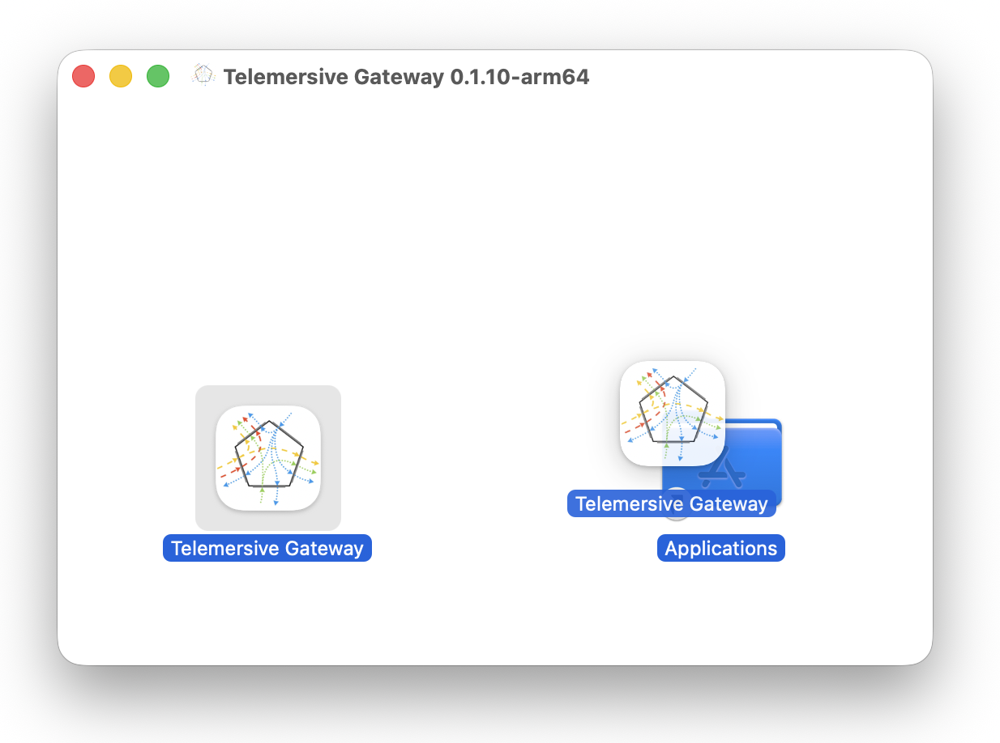
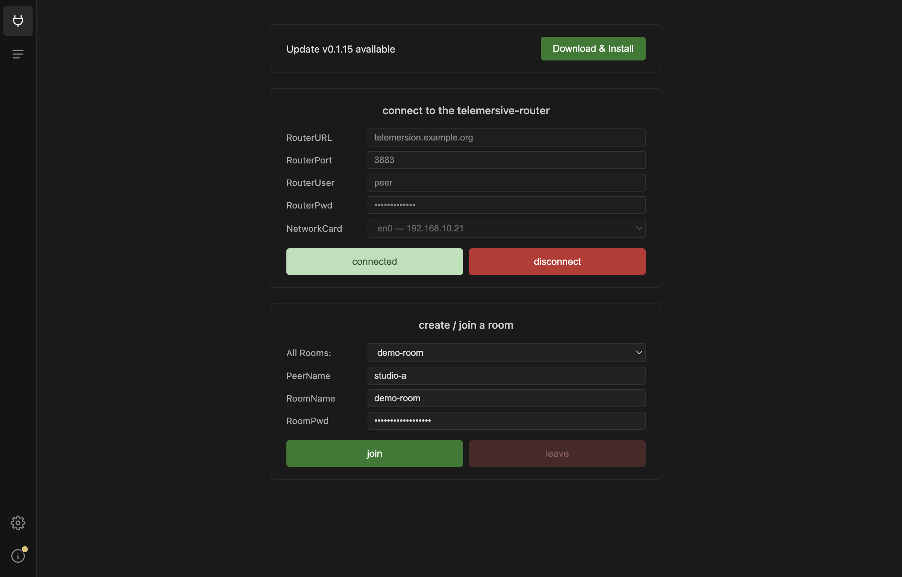

# Install

Telemersive Gateway is a standalone desktop application. Unlike the Max/MSP
version it replaces, it needs neither Max nor any Max packages.

Download the latest build from the
[releases page](https://github.com/telemersion/telemersive-portbay/releases).

=== "macOS"

    Pick the `.dmg` that matches your Mac:

    | File | For |
    | --- | --- |
    | `Telemersive-Gateway-<version>-arm64.dmg` | Apple Silicon (M1 and later) |
    | `Telemersive-Gateway-<version>-x64.dmg` | Intel |

    Open the disk image and drag **Telemersive Gateway** into *Applications*.

    The build is signed and notarised, so it should open normally. If macOS
    refuses to open it, right-click the app and choose **Open** once.

    

=== "Windows"

    Download `Telemersive-Gateway-Setup-<version>.exe` and run it. The installer
    lets you choose the installation directory and installs for all users, so it
    will ask for administrator rights.

    Windows SmartScreen may warn about an unrecognised app. Choose **More info →
    Run anyway**.

    !!! info "Screenshot pending"
        SmartScreen dialog — `os-windows-smartscreen.png`

## Updates

The Gateway checks for new releases on its own. When one is available a banner
appears on the Session view, and the **About** panel offers to download and
install it.

## External tools

Two command-line tools do the actual media work, and they are **not** bundled:

- **[UltraGrid](https://www.ultragrid.cz/)** — video and audio. Required on all
  platforms.
- **[NatNetFour2OSC](https://github.com/immersive-arts/NatNetFour2OSC)** —
  OptiTrack motion capture. Windows only.

The Gateway checks for both at startup and refuses to go any further until the check
passes. That check, and what to do when it fails, is the
[next page](tools.md).

## Firewall

The first time you enable a device, your operating system will ask whether to
allow incoming network connections. **Allow it** — without that, streams leave
your machine but nothing arrives.

If you dismissed the prompt by accident, see the [FAQ](../faq.md#firewall).

## What you connect it to

The Gateway bridges between the network and whatever produces or consumes media on
your machine:

- **Video** via Syphon (macOS), Spout (Windows) or NDI
- **Audio** via CoreAudio, PortAudio, WASAPI or JACK — see
  [Audio on macOS](../tutorials/audio-on-macos.md)
- **OSC** via plain UDP, to and from any tool that speaks it
- **Motion capture** from OptiTrack Motive

You also need access to a running **telemersive-router**, and credentials for
it. Ask whoever operates yours.
