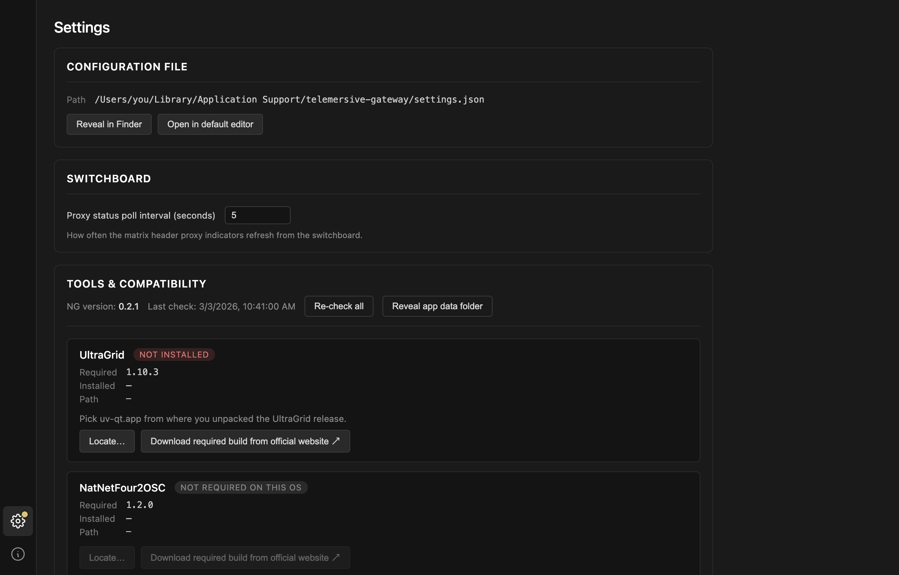
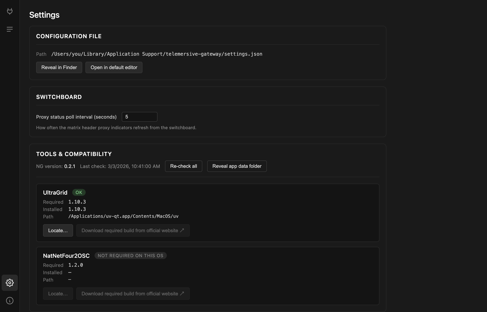

# Tools & compatibility

Portbay does not ship UltraGrid or NatNetFour2OSC. It checks for them at
startup, and **holds every other screen shut until the check passes** — there is
no point letting you build a room you cannot stream into.

While the check is failing, the icon bar shows only Settings and About, and the
Settings icon carries a badge:

## When a tool is missing

Each tool shows what it needs, what was found, and where. You have two ways
forward:

**Download required build from official website** opens the release page for the
exact version required. Versions matter: Portbay parses the tools' console
output to drive the FPS and volume indicators, and that output changes between
releases. A different version may appear to work while reporting nonsense.

**Locate…** points Portbay at a copy you already have.

- macOS: pick `uv-qt.app` from where you unpacked the UltraGrid release
- Windows: pick `uv.exe`, or `NatNetFour2OSC.exe`

**Re-check all** runs the check again after you install something, without
restarting.

## When everything is in place

`NOT REQUIRED ON THIS OS` is a pass, not a failure. NatNetFour2OSC exists only
for Windows, so on macOS and Linux that row stays grey and the
[MoCap device](../devices/mocap.md) is unavailable — the other device types are
unaffected.

Once the check is green the Session and Matrix screens unlock and Portbay takes
you to [Session](first-session.md).

## Required versions

| Tool | Version | Platforms |
| --- | --- | --- |
| UltraGrid | 1.10.3 | macOS, Windows, Linux |
| NatNetFour2OSC | 1.2.0 | Windows |

These are the versions this release of Portbay was built and tested against. If
you need a different one, the mismatch will be reported rather than silently
accepted.
