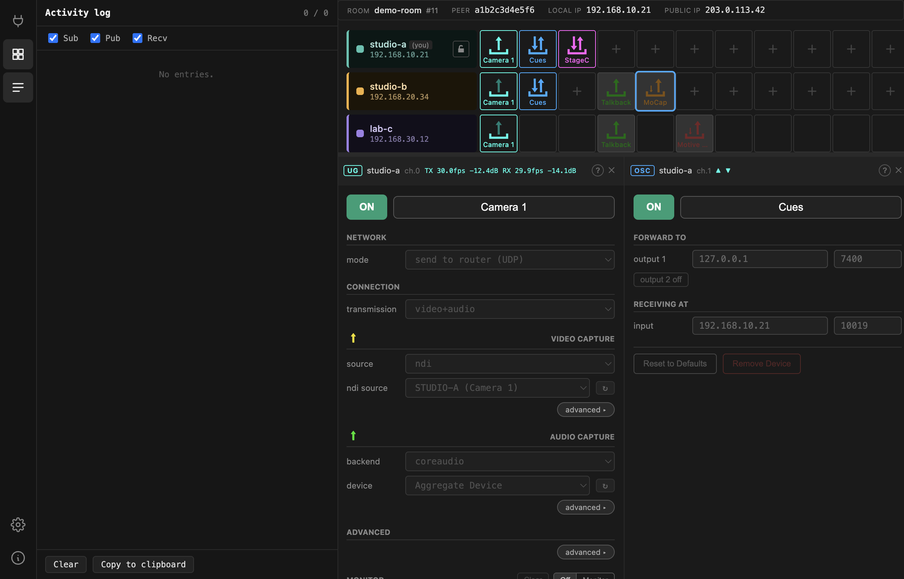

# Activity log

The Activity log shows the MQTT traffic between this app and the broker, live.



Every line is one message:

| Kind | Meaning |
| --- | --- |
| `SUB` / `UNSUB` | subscribed to / stopped listening to a topic pattern |
| `PUB` | this app published something |
| `PUB r` | published **retained** — the broker keeps it for peers joining later |
| `RECV` | something arrived from the broker |

The filters at the top switch each kind on and off; the panel keeps the last 500
lines and auto-scrolls unless you scroll up.

## Why it looks like an echo chamber

Because it is. Nothing in the Gateway acts on a change directly. Pressing a button
publishes the new value, the broker sends it back, and only *then* does anything
happen. So a single click shows up as a `PUB` immediately followed by a `RECV`
of the same topic:

```
[09:41:20.412] PUB r /peer/a1b2.../channel.0/device/gui/enable 1
[09:41:20.549] RECV  /peer/a1b2.../channel.0/device/gui/enable 1
```

The gap between those two lines is your round trip to the broker — a useful
number when the interface feels sluggish.

The same design is why a remote peer changing your device is indistinguishable
from you changing it: both arrive as a `RECV` on the same topic.

## What to look for

**A `PUB` with no matching `RECV`** — the broker did not accept or echo the
message. Usually the connection has dropped.

**`RECV` on a peer you did not expect** — someone else is editing that channel.

**Nothing at all after joining** — subscriptions never established. Leave and
rejoin.

**Retained clears** — empty values on topics you used to own, which is what a
device teardown looks like when it removes its state from the broker.

## Reading the topics

Topics follow a fixed shape:

```
/peer/<peerId>/rack/page_0/channel.<n>/loaded
/peer/<peerId>/rack/page_0/channel.<n>/device/gui/<field>
/peer/<peerId>/settings/<field>
```

`loaded` is the device type on that channel: `0` empty, `1` OSC, `2` UltraGrid,
`3` MoCap, `4` StageControl, `5` Motive bridge. Everything under `device/gui/`
is that device's configuration.

**Copy** puts the visible lines on the clipboard — the right thing to attach to
a bug report. Check it for your room name and peer names before sending it
anywhere.
