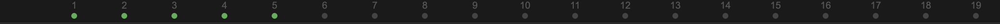
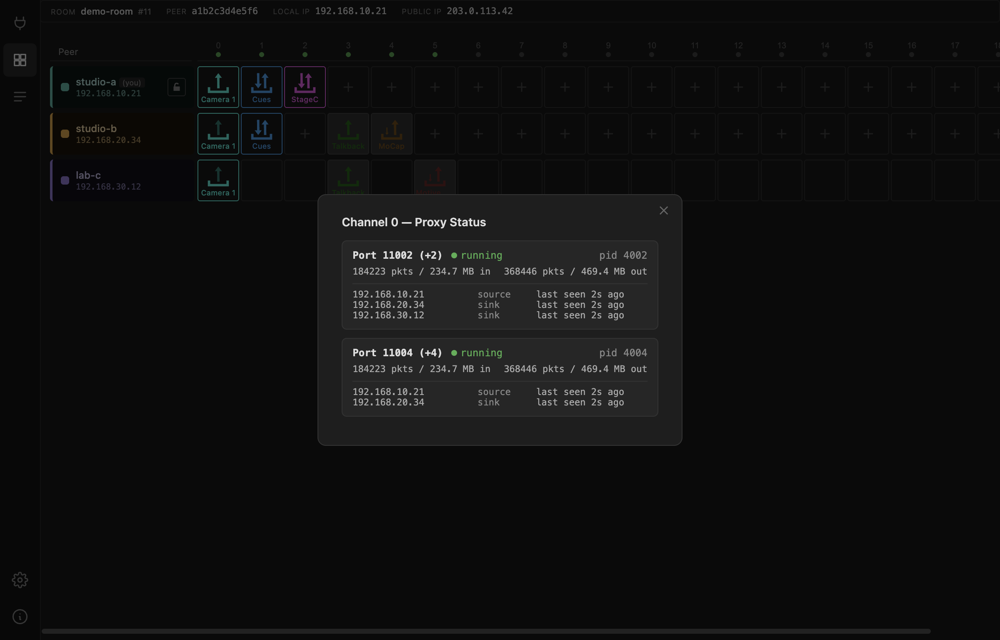

# Channel proxies

Each channel needs **proxy processes** running on the router to relay its UDP
traffic between peers. The dots under the channel numbers show whether they are
there.

| Dot | Meaning |
| --- | --- |
| Green | every proxy this channel needs is running |
| Grey | no proxy running — nothing has claimed this channel yet |
| Red | the switchboard reported a problem, or could not be reached |

Grey is normal for unused channels. The switchboard starts proxies as channels
come into use, so a channel you have just populated may take a moment to go
green.

## Inspecting a channel

Click a channel number.

For each proxy on that channel you get its port, whether it is running, its
process ID, the traffic it has passed, and which peers are currently registered
with it and in what role.

That client list is the useful part. It answers the question the matrix cannot:
**is the other side actually attached to the relay?** A sender lit up and a
receiver dark, with only one client registered on the proxy, means the receiving
peer never reached the router — a firewall on their end, or the wrong
NetworkCard.

## Why several proxies per channel

Because a channel carries more than one stream. An UltraGrid channel sending
video and audio uses separate ports for each, and separate ports again for the
receive direction; an OSC channel uses one port for each direction plus a second
output. Which slot gets which port is laid out in [Ports](../reference/ports.md).

## Refresh rate

The Gateway polls the switchboard every 5 seconds by default. Change that under
[Settings](settings.md) if you want a livelier display or less chatter.

!!! note "Proxy state is the router's view, not yours"
    A green dot means the relay exists and is running. It does not mean your
    packets are reaching it. For that, watch the arrows in the matrix and the
    client list in this modal.
