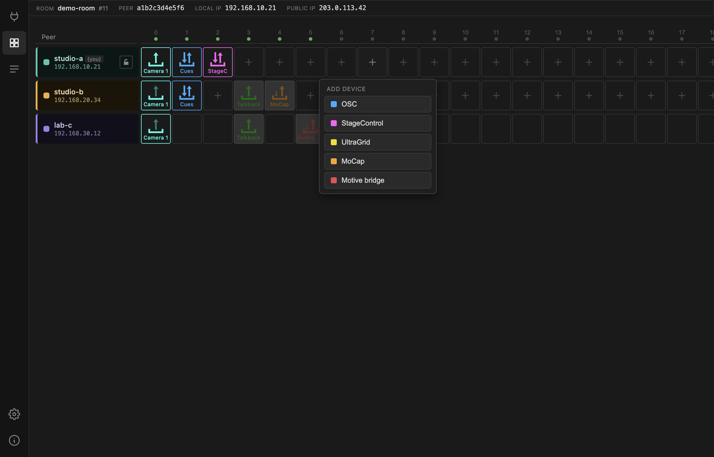
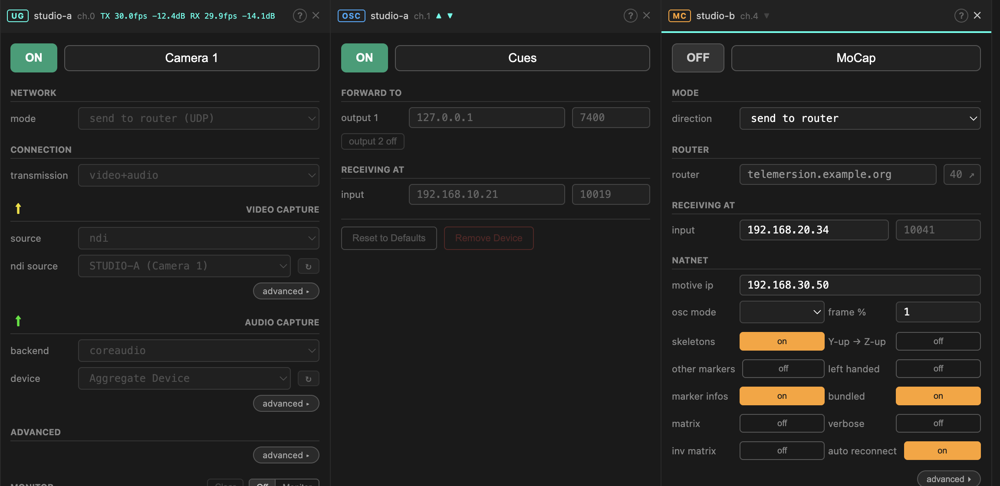

# Adding & removing devices

## Add a device

Click the `+` in an empty cell.

| | Device | |
| --- | --- | --- |
|  | **[OSC](../devices/osc.md)** | OSC messages between peers |
|  | **[StageControl](../devices/stage-control.md)** | browser-based OSC surface |
|  | **[UltraGrid](../devices/ultragrid.md)** | video and audio |
|  | **[MoCap](../devices/mocap.md#mocap-natnetfour2osc)** | OptiTrack via NatNetFour2OSC |
|  | **[Motive bridge](../devices/mocap.md#motive-bridge)** | native NatNet, re-multicast |

A device type greyed out as *not available on this peer* means the target
machine cannot run it — most often MoCap on a peer that is not on Windows. The
choice is offered based on what **that** peer reports, not what your machine
can do.

The new device arrives with sensible defaults, its ports already allocated, and
switched **off**.

!!! note "You can add devices to other peers"
    Adding a device to someone else's row publishes only the device *type*.
    Their machine fills in the rest — IP addresses, ports, defaults — because
    only it knows what its own hardware looks like. This is why a device you
    create remotely takes a moment to fill in.

## Remove a device

Open the device's panel and press **Remove Device**, or right-click its cell.
You will be asked to confirm; removal stops the device and clears all of its
settings.

A running device cannot be removed — switch it **off** first. The Remove button
stays disabled while it is on.

## The panel row

Clicking a device cell opens its panel in a row docked at the bottom.

Each panel header shows the device type badge, which peer and channel it belongs
to, and live activity — for UltraGrid, the TX/RX frame rate and volume.

- **?** opens this page's documentation for that device type in your browser.
- **Pin** (the pin icon) keeps the panel open when you select another cell.
  Without pinning, selecting a different device replaces the panel.
- **Close** (×) removes a pinned panel.
- **Drag** a pinned panel's header to reorder.
- **Drag the divider** above the row to resize it. The height is remembered.

Pinning is how you compare peers: pin your sender and the other side's receiver
next to each other and watch both indicators at once.

## Switching a device on

Every panel has an **ON/OFF** button at the top left, and a free-text
description next to it that defaults to the device type name.

While a device is **on, its settings are locked**. This is deliberate — changing
a port under a running stream does nothing good. Switch off, change, switch on.

The description is yours to use: `Camera 1`, `Talkback`, `Cues` read far better
in the matrix than five cells all saying `UG`. The description is a label only;
the app dispatches on the device type, never on what you call it.

## Editing other peers' devices

Any peer can configure any other peer's devices. A remote peer editing your
channel and you editing it yourself take exactly the same path through the app —
there is no difference between them internally.

That is powerful during a rehearsal, when one person can set up every location
from one seat. When you would rather people kept their hands off, lock your row
— see [Peer details & locking](peer-detail.md).

!!! info "Why interactions take a moment"
    Every change is published to the broker and only acted on when it comes back
    to you. On a public broker that round trip is 50–200 ms, so buttons respond
    with a slight delay. It also means that while the broker is unreachable you
    cannot toggle anything — though streams already running keep running, since
    the media itself never goes through the broker.
