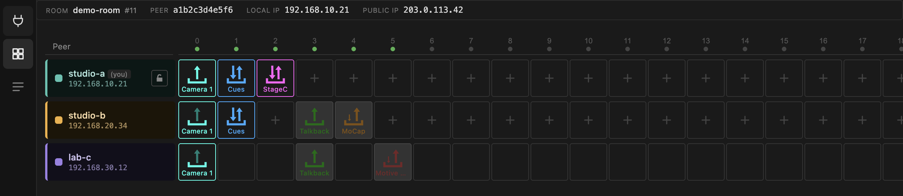
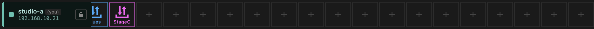
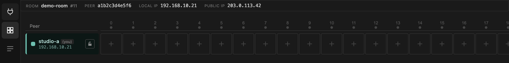

# The matrix

The matrix is the room. Rows are peers, columns are channels.

**Devices in the same column can exchange data.** That is the whole idea. A
channel is a shared lane through the router: whatever `studio-a` sends on
channel 0, everyone with a receiving device on channel 0 gets.

Channels do not carry types. Nothing stops you putting an OSC device on the same
channel as someone else's UltraGrid device — they simply will not talk to each
other, because they use different ports inside that channel's range. Keeping one
kind of traffic per channel is a convention that keeps rooms readable, not a rule
the app enforces.

## The header

| | |
| --- | --- |
| **ROOM** | room name and number. The number decides the port range — see [Ports](../reference/ports.md). |
| **PEER** | your peer ID for this session. Regenerated every launch. |
| **LOCAL IP** | the address on the NetworkCard you picked. This is what local tools use to reach your devices. |
| **PUBLIC IP** | how the router sees you. |

## Your row and everyone else's

Your own row is always first and tagged `(you)`. Each peer gets a colour, which
you can change in the [peer detail panel](peer-detail.md).

The 20 channels follow. Empty cells on rows you are allowed to edit show a `+`;
on a locked peer's row they stay blank, because there is nothing you can do
there.

## Reading a cell

A cell shows the device type by colour, its description as a label, and an icon
for which way data moves.

| Arrow | Meaning |
| --- | --- |
| Up | from your machine to the router |
| Down | from the router to your machine |
| Both | sending and receiving |
| Sideways / loop | between your machine and its own LAN, not through the router |

Brightness is the live part:

| Look | State |
| --- | --- |
| Grey cell, grey icon | device exists but is switched off |
| Dark cell, dim colour | switched on, no data moving |
| Dark cell, full colour | switched on, data moving right now |

So a room where everything is configured correctly but nothing is running looks
dim; a room in use lights up. A device that is on but stays dim is the first
thing to investigate.

!!! tip "Dim when you expect bright"
    Nearly always the firewall, on the receiving side. See the
    [FAQ](../faq.md#firewall).

## Scrolling and selecting

All 20 channels are always present; the grid scrolls sideways when the window is
too narrow.

- **Click a device cell** to open its [panel](devices.md#the-panel-row) at the
  bottom.
- **Click a peer's name block** to open its [detail panel](peer-detail.md).
- **Click the empty area** to clear the selection and close the panel row.
- **Click a channel number** in the header to inspect that channel's
  [proxies](channel-proxies.md).

## An empty room

Right after joining you are alone with 20 empty channels. Remote peers appear as
they join, with whatever devices they already had — device state is retained on
the broker, so a peer that rejoins brings its rack back with it.
