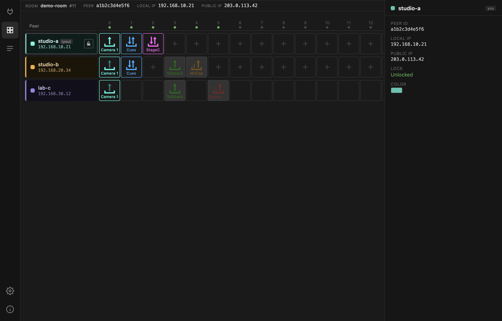

# Peer details & locking

Click a peer's name block in the matrix to slide in its detail panel.

| Field | |
| --- | --- |
| **PEER ID** | identifier for this session. Regenerated on every launch, so it is not a stable way to refer to a machine — the peer name is. |
| **LOCAL IP** | the peer's address on its own LAN. |
| **PUBLIC IP** | how the router sees it. |
| **LOCK** | whether this peer accepts remote changes. |
| **COLOR** | the peer's colour in the matrix. |

Below those, the panel geolocates the public IP and shows the peer's
approximate city, timezone, coordinates and ISP, with a map. This is a rough
lookup of the *network's* location, not of the machine — it is there to answer
"which site is this?" at a glance, and it is often off by a city.

Press ++esc++ or click outside to close.

## Colour

Click the colour swatch to pick a new one. It is yours, it is stored with your
settings, and every peer in the room sees it — colour-coding locations is worth
the ten seconds it takes.

## Locking your row

The lock button in your own row toggles whether other peers may change your
devices.

| | |
| --- | --- |
| **Unlocked** | anyone in the room can add, configure and remove your devices |
| **Locked** | your row is read-only to everyone else |

When you lock, other peers see your empty cells without a `+`, and your device
panels open with everything disabled.

!!! warning "The lock is a convention, not a security boundary"
    It is enforced in the interface, not on the wire. Nothing stops modified or
    older software from ignoring it, and it gives you no protection from anyone
    who should not be in the room. It exists so colleagues do not change your
    setup mid-rehearsal by accident — that is all it is for.

    This is deliberate: the app matches the Max gateway's protocol exactly so
    mixed rooms work, and that protocol has no permission model.

Room access control is the room password, and that is the only real boundary.
