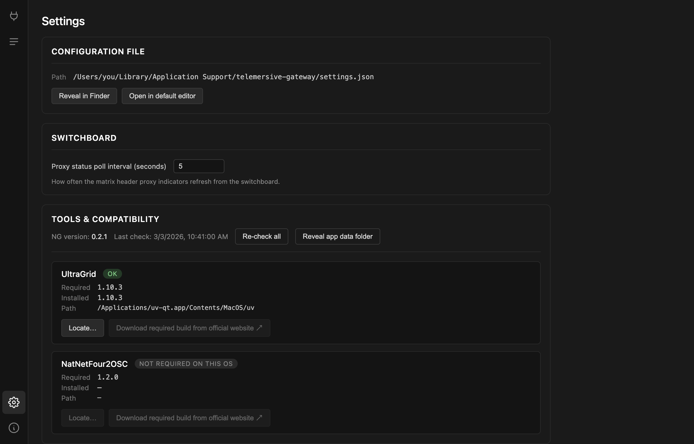
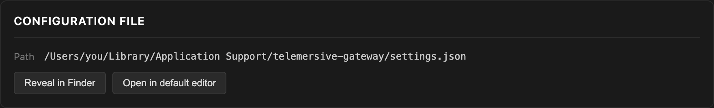

# Settings

## Configuration file

Your router credentials, peer name, last room and interface choice live in a
`settings.json`:

| Platform | Location |
| --- | --- |
| macOS | `~/Library/Application Support/telemersive-gateway/settings.json` |
| Windows | `%APPDATA%\telemersive-gateway\settings.json` |
| Linux | `~/.config/telemersive-gateway/settings.json` |

**Reveal in Finder / Explorer** and **Open in default editor** take you there.
Your rack — which devices are on which channels, and how they are configured —
is saved next to it in `rack.json`.

!!! warning "settings.json contains your router password in plain text"
    Do not attach it to bug reports or commit it anywhere.

## Switchboard

**Proxy status poll interval** controls how often the
[channel proxy indicators](channel-proxies.md) refresh, between 1 and 60
seconds. The default of 5 is a reasonable compromise; lower it while debugging a
channel, raise it if you would rather the app stayed quiet.

## Tools & compatibility

Covered on its own page — see [Tools & compatibility](../getting-started/tools.md).

**Re-check all** re-runs the check without restarting. **Reveal app data folder**
opens the directory holding settings, rack and logs.

## Saving and loading racks

The **File** menu has more than the Settings screen shows:

| Item | |
| --- | --- |
| **Save** (++cmd+s++ / ++ctrl+s++) | write settings and rack now, instead of waiting for the autosave |
| **Save Rack As…** | export the current rack to a file you can keep or share |
| **Save Settings As…** | export settings to a file |
| **Open Rack…** | load a rack file, applied on your next room join |
| **Open Settings…** | load a settings file |

Rack files are how you keep a production setup. Build the channel layout once,
save it, and reload it for the next rehearsal instead of rebuilding by hand.

**Open Rack…** and **Open Settings…** are disabled while you are connected — both
take effect at join time, so they have to be chosen before you connect.

!!! note "Rack files are not portable between peers as-is"
    A rack records your local ports and device settings. Loading someone else's
    rack gives you their layout, but addresses pointing at their machines. Treat
    a shared rack as a starting point.

## What is saved automatically

Everything, continuously. Any change to your own devices or settings is written
to disk shortly after you make it, so an unexpected quit costs you nothing. The
one thing that is *not* preserved is your peer ID, which is new every launch.
