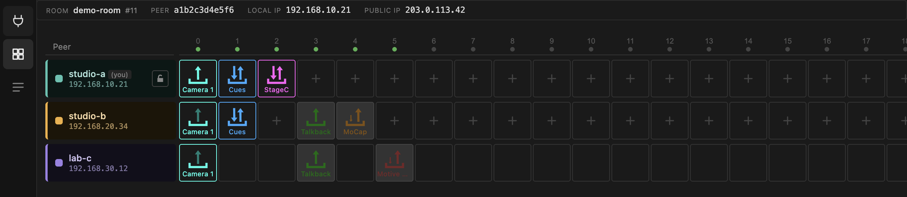
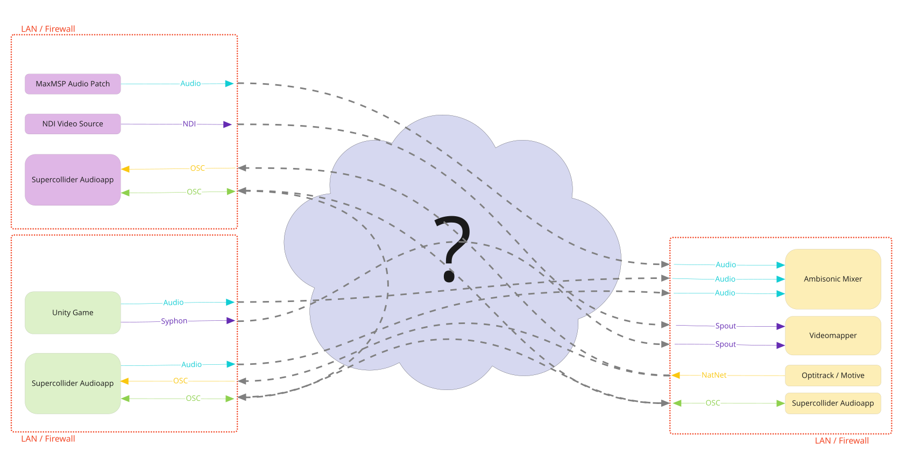
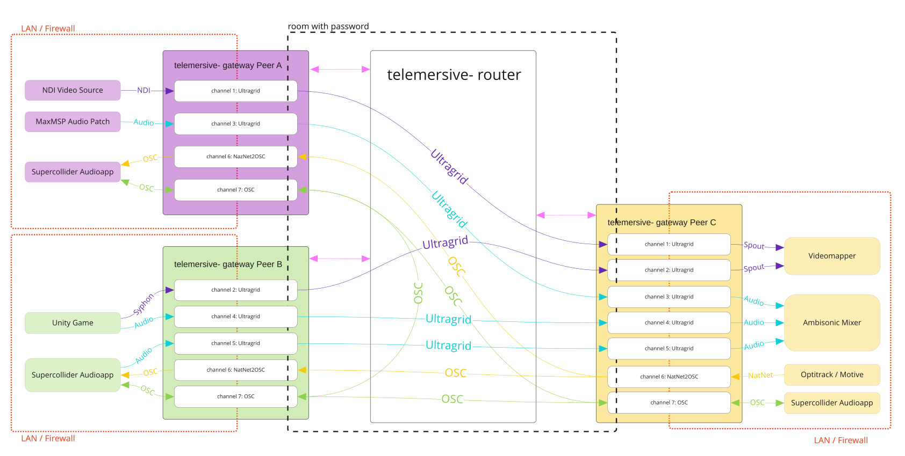
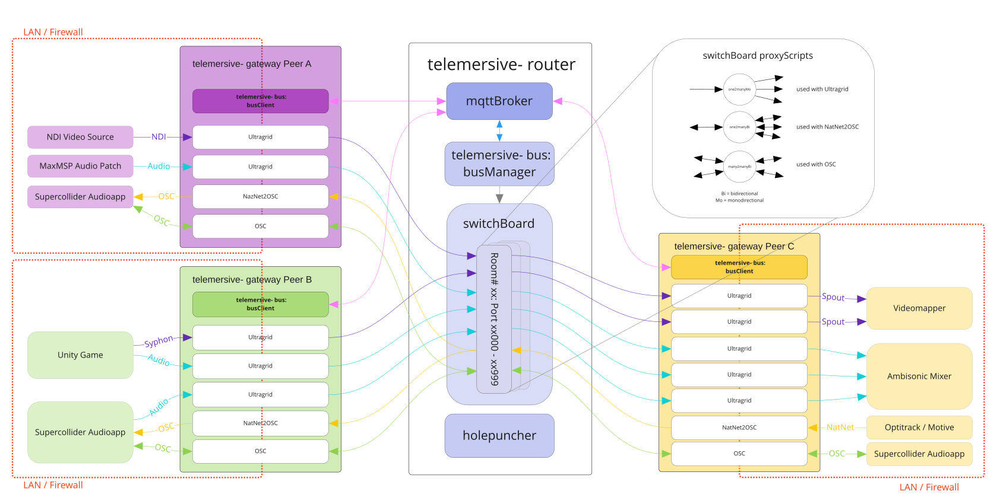

# Telemersive Gateway

Share video, audio, OSC and motion capture between locations whose firewalls you
cannot change.

## The problem

Say you have three locations on three separate networks, each behind a firewall
whose administrators have no intention of changing anything — a university, for
instance.

You need to move several data streams between those locations with as little
latency as possible, without disturbing the networking between machines inside
each LAN.

## How it is solved

Two components:

- the **[telemersive-router](https://github.com/telemersion/telemersive-router)**,
  running on a server with a public IP address
- the **Telemersive Gateway** (this app), running on every participating machine

Each Gateway joins a **room** on the router, either creating it or entering an
existing one with its password. Peers in the same room can share their data
sources. Each peer opens **devices** that carry the actual media; the router
mediates between them, so no firewall rule has to change.

## What you work with

A room is a grid. Columns are **channels** (20 of them), rows are **peers**.
Devices in the same column can exchange data.

| Device | Carries |
| --- | --- |
|  **OSC** | OSC messages between peers and your local tools |
|  **Stage Control** | a browser-based OSC surface, one instance per room |
|  **UltraGrid** | low-latency video and audio |
|  **MoCap** | OptiTrack motion capture converted to OSC |
|  **Motive bridge** | native Motive/NatNet streams, re-multicast at the far end |

You can drive any peer's devices from any other peer in the room, unless that
peer has locked its row.

## Where to start

- **[Install](getting-started/install.md)** — download and first launch
- **[Tools & compatibility](getting-started/tools.md)** — the check that gates the app
- **[Your first session](getting-started/first-session.md)** — connect, join, and see a room
- **[The matrix](guide/matrix.md)** — how to read the grid

## Under the hood

Not required reading, but useful when something misbehaves.

At the core is the
**[telemersive-bus](https://github.com/telemersion/telemersive-bus)**, which
connects clients through an [MQTT](https://en.wikipedia.org/wiki/MQTT) broker
that is part of the router. A bus manager organises room creation and access,
talking to the
**[switchBoard](https://github.com/telemersion/telemersive-switchBoard)**.

Every room gets a port range on the router — room 11 gets 11000–11999 — and the
switchboard starts a set of small **proxy scripts** inside it. Each proxy simply
forwards the UDP packets it receives to the peers connected to it:

- one-to-many, one direction — receives on one port, sends on another
- one-to-many, bidirectional — one port for the "one", one for the "many"
- many-to-many, bidirectional — receives and sends on the same port

A **holepuncher** service supports the direct peer-to-peer UltraGrid mode, which
skips the router entirely.

See **[Ports](reference/ports.md)** for how channel numbers become port numbers,
and **[Max compatibility](reference/max-compatibility.md)** for what this app
shares with its Max/MSP predecessor.
