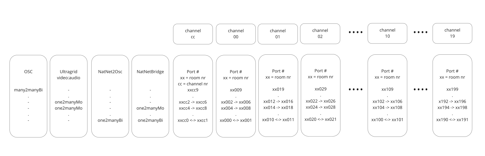

# Ports

The Gateway works with **two separate port spaces**. Confusing them is the root of
most "but the port is right there" problems.

| | **Local ports** | **Room ports** |
| --- | --- | --- |
| Prefix | always `10` | the room number |
| Example (room 11, channel 0) | `10009` | `11009` |
| Used for | your own tools ↔ the Gateway | the Gateway ↔ the router's proxies |
| Shown in the interface | yes | no |
| Changes when you join another room | **no** | yes |

**You only ever need local ports.** They are the ones the panels show, and the
ones you put into a Max patch or an OSC tool.

Room ports are derived by every peer from the room number and channel, so they
never have to be communicated — which is why they are not displayed.

!!! tip "Why local ports are fixed at 10xxxx"
    So that rejoining a different room does not break your setup. Channel 1's
    local OSC input is `10019` in every room, forever. If local ports followed
    the room number, every patch would break the moment you moved rooms.

## How a port is built

```
port = prefix × 1000  +  channel × 10  +  slot
```

- **prefix** — `10` for local ports, the room number for room ports
- **channel** — 0–19
- **slot** — which stream within the channel

So room 11, channel 5, slot 9 is `11059`; the local equivalent is `10059`.

## Slots by device type

| Device | Slot | Carries |
| --- | --- | --- |
| **OSC / Stage Control** | +7 | output 2 |
| | +8 | output 1 |
| | +9 | input |
| **UltraGrid** | +2 | video (send) |
| | +4 | audio (send) |
| | +6 | video (receive) |
| | +8 | audio (receive) |
| **MoCap** | +0 | to the router |
| | +1 | from the router |
| **Motive bridge** | +0 | NatNet command channel |
| | +2 | data, Source → router |
| | +6 | data, router → Sink |

**Stage Control** additionally uses one port per room for the web interface
itself: `roomId × 1000 + 902` — `11902` for room 11.

### Worked example

Room 11, channel 3, an OSC device:

| | |
| --- | --- |
| Local input — send your OSC here | `10039` |
| Local output 1 — where received OSC is forwarded | your chosen address |
| Room input, peer → proxy | `11039` |
| Room output, proxy → peer | `11038` |

## The room's range

Each room gets a 1000-port range on the router: room 11 gets 11000–11999. Only
the first 200 are used, which is what bounds a room to 20 channels.



## Firewall rules

If you have to write firewall rules rather than answer a prompt, what needs to
pass is:

- **outbound UDP** to the router on that room's range
- **inbound UDP** on your local `10xxx` ports, for the return traffic

The Gateway itself also needs **outbound TCP** to the broker port, `3883` by default.

Media is UDP throughout and never passes through the broker. That is why a
broker outage costs you control but not streams.
